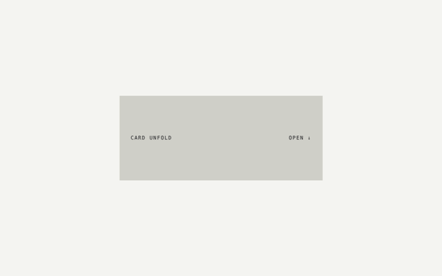
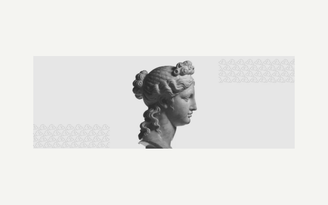
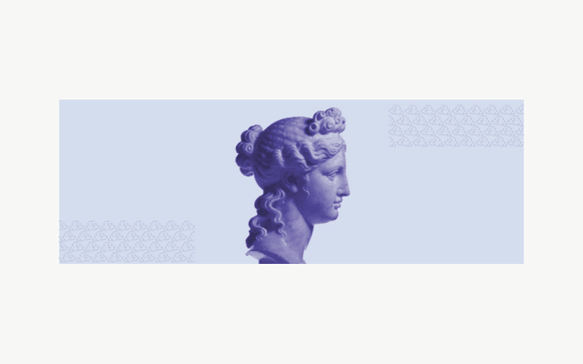
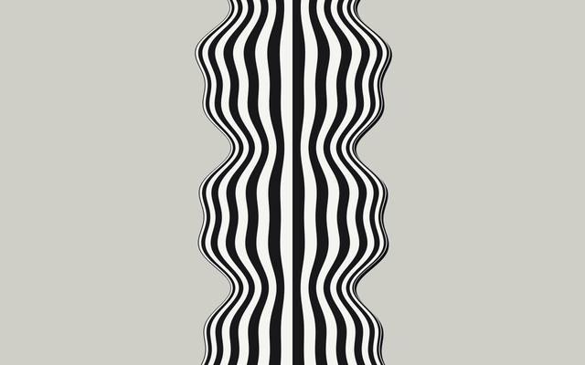
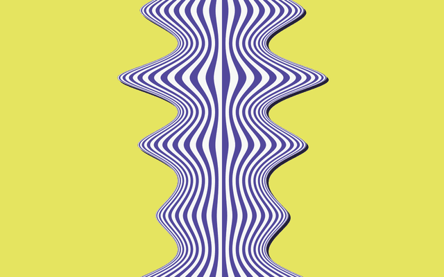
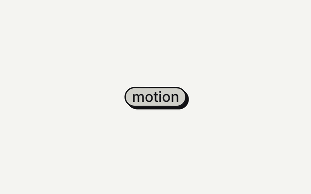
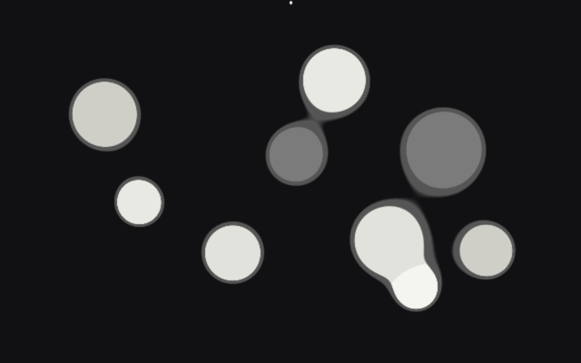
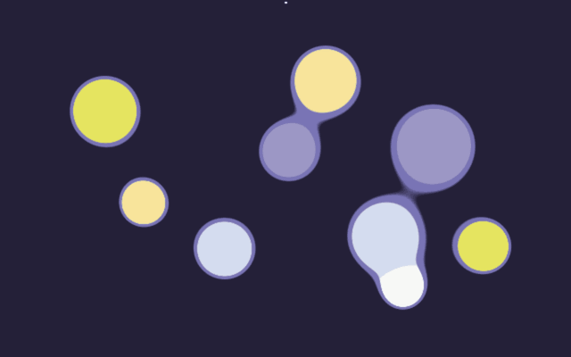
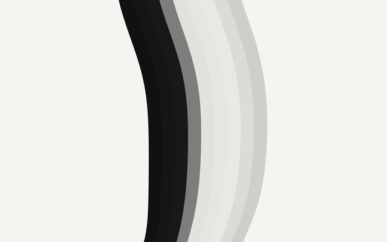
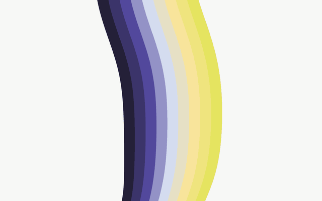

# motion-studies

Small motion pieces for websites and digital pages. Some are driven by scroll, some by the pointer, and some by both. Each study is one HTML file with no libraries and no build step. Open it in a browser, change a few variables, and drop it into your own site.

**See them live:** [lucieoken-create.github.io/motion-studies](https://lucieoken-create.github.io/motion-studies/)

## The studies

### 01 · Card unfold

`Scroll`

A card folded in three opens on its hinges as you scroll, then grows until it fills the screen.

| Neutral | hijinx theme (default) |
| --- | --- |
|  |  |

[Open it live](https://lucieoken-create.github.io/motion-studies/card-unfold/) · [Code](card-unfold/index.html)

### 02 · Card flip

`Scroll`

A wide photo splits into four strips. Each strip flips over, one after another, and lands as a playing card with its back showing. Then the cards fan out into a hand. You can try it with your own photo right on the page.

| Neutral | hijinx theme (default) |
| --- | --- |
|  |  |

[Open it live](https://lucieoken-create.github.io/motion-studies/card-flip/) · [Code](card-flip/index.html)

### 03 · Stripe swell

`Scroll`

Bulges drift slowly down a column of stripes, mirrored exactly left and right. Scrolling makes them swell, then widens the column until the stripes are the whole page.

| Neutral | hijinx theme (default) |
| --- | --- |
|  |  |

[Open it live](https://lucieoken-create.github.io/motion-studies/stripe-swell/) · [Code](stripe-swell/index.html)

### 04 · Type cascade

`Pointer`

One word, repeated, turns slowly like oil on water: quicker in the middle, slower at the rim. The swirl is lumpy, with more layers in some directions than others, like the teeth of a gear. The shapes around the words melt together and pull apart, while the words stay sharp. Move your pointer through it and the words get out of the way. This one does not use scroll: it is one screen tall and just plays. You can type your own word right on the page.

| Neutral | hijinx theme (default) |
| --- | --- |
|  |  |

[Open it live](https://lucieoken-create.github.io/motion-studies/type-cascade/) · [Code](type-cascade/index.html)

### 05 · Fluid blobs

`Scroll` `Pointer`

It starts as plain circles of color drifting past each other. Scrolling melts them: neighbors pool into thick blobs, and their colors bleed where they meet. Your pointer is a circle too.

| Neutral | hijinx theme (default) |
| --- | --- |
|  |  |

[Open it live](https://lucieoken-create.github.io/motion-studies/fluid-blobs/) · [Code](fluid-blobs/index.html)

### 06 · Ribbon twist

`Scroll`

One ribbon of color glides down the page in slow curves. Scrolling deepens the curves, then turns the ribbon over so you see its other side.

| Neutral | hijinx theme (default) |
| --- | --- |
|  |  |

[Open it live](https://lucieoken-create.github.io/motion-studies/ribbon-twist/) · [Code](ribbon-twist/index.html)

## Use one in your project

1. Copy the study's `index.html` (and any image it points to in `assets/`).
2. Restyle it by changing the variables at the top of the `<style>` block: colors, fonts and the mark on the card backs. Everything else reads from them.
3. Swap the content. The unfold's card face lives in the `<template>` near the bottom of the page; the flip's picture is the `PHOTOS` list at the top of its script, one per theme.
4. Retime it. Each script has a short "timing" block where every step is a slice of scroll progress from 0 to 1. The section's `height` (420vh) sets how much scrolling the whole thing takes.

Studies 03 to 06 are drawn on a canvas, so there's no markup to swap. Their content is a few constants at the top of the script: the number of stripes or bands, the word in the swirl (`WORDS`, one per theme), how many circles there are, and `LOOP`, the number of seconds before the motion repeats exactly. Their colors still come from the same theme variables.

Every study respects reduced motion: people who've turned animation off in their settings see the finished state, still.

## Themes

Every study ships with two themes. **hijinx**, the palette and type from [hijinx.studio](https://hijinx.studio), is what the pages open in. **Neutral** is a plain monochrome version to start your own from. Switch with the button in the top corner, or add `#neutral` to the URL. A theme changes the art too: neutral draws its placeholders in code (a wireframe globe, a flat landscape, a crosshatch card back), so there are no image files to license, and hijinx uses Lucie's own artwork. To add your own, copy the `[data-theme="hijinx"]` block, rename it and change the values, then add your art for that theme.

## Use them with Claude or another AI coding tool

`SKILL.md` tells an AI agent how these studies are built and how to adapt one to a project's design tokens. In Claude Code, put this folder in your skills directory (or just point Claude at the repo) and ask for something like "add the card flip to the team page using our brand colors."

## How they work

The two card studies draw an image once and slice it into pieces, then move the pieces with 3D CSS transforms. When the pieces sit flat, the seams disappear and it reads as one picture. Scroll position drives everything, so scrolling back up plays it in reverse. Depth comes from flat shades and hard offset shadows, not gradients or blur.

The four canvas studies redraw every frame from two numbers: scroll progress (0 to 1) and the time in seconds. Scroll decides the big change and time adds the drift, so each one is still alive when you stop scrolling. Stripe swell and ribbon twist fill shapes between curves. Type cascade and fluid blobs are drawn pixel by pixel on a small canvas that is stretched to fit: every word or circle spreads into the pixels around it, the way a blur would, and then each pixel is made either solid or clear. Where two spreads overlap they add up, which is why shapes reach for each other and merge. Those two also react to the pointer.

## Credits

Studies 03 to 06 started from pieces on [brik.space](https://brik.space) and were rebuilt from scratch with different motion, color and code: [Le Parc - Visual Blueprint](https://brik.space/tools/remix-of-visual-blueprint-studio-mpzo7ppa) and [Liquid Rainbow Topography Hero](https://brik.space/tools/liquid-topography-hero-remix-remix-mpzo70fv) by Maya Netzer, [type for fun 04](https://brik.space/tools/remix-of-remix-of-cascade-type-msfywfiu) by Clueless studio, and [BLB](https://brik.space/tools/thresholded-fluid-blo-mo8z7jxh) by Or Yogev.

Made by [Lucie Oken](https://hijinx.studio) of hijinx. The marble bust and the ASCII disco ball in the hijinx theme are Lucie's own and are included under the same license. MIT licensed: use these anywhere, including client work, and keep the license notice.
