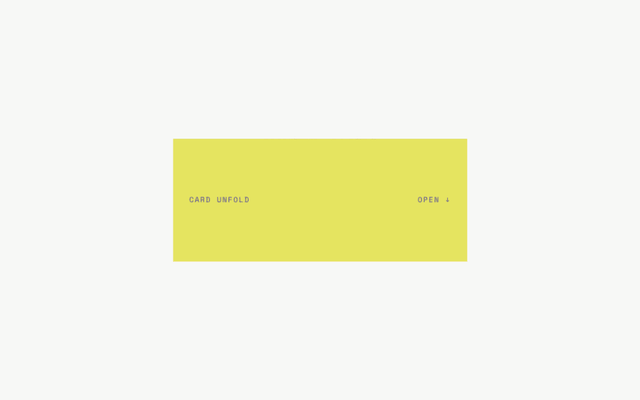

# motion-studies

Small scroll animations for marketing pages. Each study is one HTML file with no libraries and no build step. Open it in a browser, change a few variables, and drop it into your own site.

**See them live:** [lucieoken-create.github.io/motion-studies](https://lucieoken-create.github.io/motion-studies/)

## The studies

### 01 · Card unfold

A card folded in three opens on its hinges as you scroll, then grows until it fills the screen.

| Neutral (default) | hijinx theme |
| --- | --- |
|  |  |

[Open it live](https://lucieoken-create.github.io/motion-studies/card-unfold/) · [Code](card-unfold/index.html)

### 02 · Card flip

A wide photo splits into four strips. Each strip flips over, one after another, and lands as a playing card with its back showing. Then the cards fan out into a hand. You can try it with your own photo right on the page.

| Neutral (default) | hijinx theme |
| --- | --- |
|  |  |

[Open it live](https://lucieoken-create.github.io/motion-studies/card-flip/) · [Code](card-flip/index.html)

## Use one in your project

1. Copy the study's `index.html` (and any image it points to in `assets/`).
2. Restyle it by changing the variables at the top of the `<style>` block: colors, fonts and the mark on the card backs. Everything else reads from them.
3. Swap the content. The unfold's card face lives in the `<template>` near the bottom of the page; the flip's picture is the `PHOTOS` list at the top of its script, one per theme.
4. Retime it. Each script has a short "timing" block where every step is a slice of scroll progress from 0 to 1. The section's `height` (420vh) sets how much scrolling the whole thing takes.

Both studies respect reduced motion: people who've turned animation off in their settings see the finished state, still.

## Themes

Every study ships with two themes. **Neutral** is the default. **hijinx** is the palette and type from [hijinx.studio](https://hijinx.studio). Switch with the button in the top corner, or add `#hijinx` to the URL. A theme changes the art too: neutral draws its placeholders in code (a wireframe globe, a flat landscape, a crosshatch card back), so there are no image files to license, and hijinx uses Lucie's own artwork. To add your own, copy the `[data-theme="hijinx"]` block, rename it and change the values, then add your art for that theme.

## Use them with Claude or another AI coding tool

`SKILL.md` tells an AI agent how these studies are built and how to adapt one to a project's design tokens. In Claude Code, put this folder in your skills directory (or just point Claude at the repo) and ask for something like "add the card flip to the team page using our brand colors."

## How they work

Both studies draw an image once and slice it into pieces, then move the pieces with 3D CSS transforms. When the pieces sit flat, the seams disappear and it reads as one picture. Scroll position drives everything, so scrolling back up plays it in reverse. Depth comes from flat shades and hard offset shadows, not gradients or blur.

## Credits

Made by [Lucie Oken](https://hijinx.studio) of hijinx. The marble bust and the ASCII disco ball in the hijinx theme are Lucie's own and are included under the same license. MIT licensed: use these anywhere, including client work, and keep the license notice.
